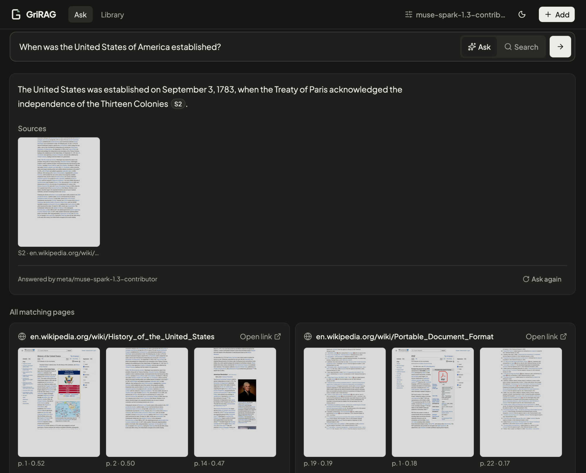
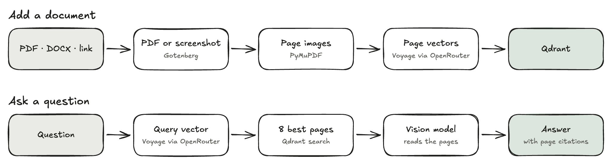

# GriRAG

Ask questions about your PDFs, Word files and web pages. GriRAG reads every page as an image, so tables,
charts and layout survive, and answers with citations to the exact pages it used. It runs on your computer,
for one user.

**[Read the documentation →](https://gri-rag.mintlify.site)**



## How it works

<picture>
  <source media="(prefers-color-scheme: dark)" srcset="docs/images/pipeline-dark.png">
  
</picture>

Every document becomes page images, and each page is embedded with a multimodal model and stored in Qdrant.
A question is embedded the same way, and the 8 closest pages go to a vision model, which answers only from them
and cites each page it used ([S1], [S2], …). More in the
[architecture docs](https://gri-rag.mintlify.site/architecture).

The approach follows [PixelRAG](https://github.com/StarTrail-org/PixelRAG) (Apache-2.0). No PixelRAG code is
used; the answer prompt is adapted from its `SYSTEM_PROMPT_EVIDENCE_QA`.

## Quick start

Runs on macOS and Linux. Needs Docker ([Docker Desktop](https://www.docker.com/products/docker-desktop/), or on
Linux Docker Engine with the Compose plugin), `make` (macOS: `xcode-select --install`; Debian/Ubuntu:
`sudo apt install make`) and an OpenRouter account with a few dollars of credit. Adding pages costs about $1 per
1,000, a question under $0.001.

1. Clone and create the settings file:
   ```bash
   git clone https://github.com/Grihladin/GriRAG.git && cd GriRAG
   cp .env.example .env
   ```
2. Create a key at https://openrouter.ai/settings/keys and put it into `.env` as `OPENROUTER_API_KEY`.
3. Start it (the first build takes a few minutes; on macOS it opens Docker Desktop if needed):
   ```bash
   make up
   ```
4. Open http://127.0.0.1:8000, click **Add**, drop in a PDF or paste a link, and ask a question once its status
   is ready.

Your library lives in `data/`. `make down` stops everything; after a `git pull`, run `make up` again.

## Limitations

- No OCR, keyword search or follow-up questions.
- Answers read the 8 best pages (`ANSWER_PAGES`), so facts spread over more pages can be missed.
- Web pages keep their first 40 pages; logged-in and paywalled sites index the login page.
- No authentication: keep it on 127.0.0.1.

## License

[MIT](LICENSE)
