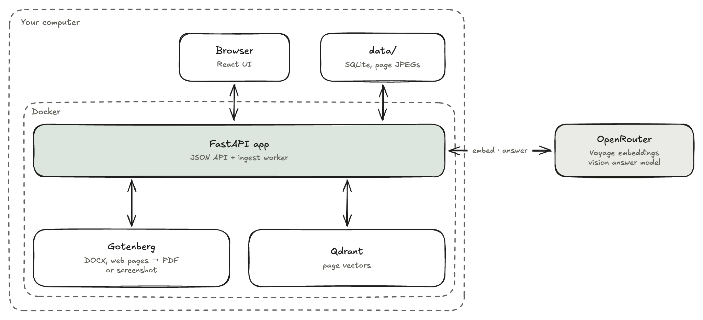
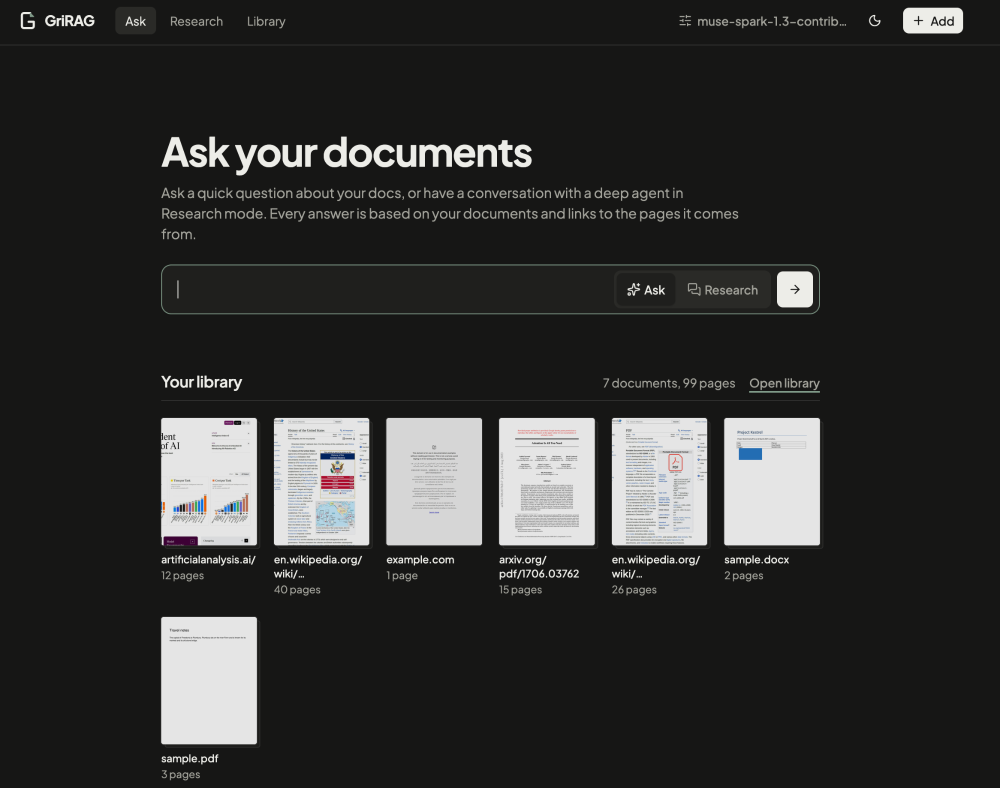

# GriRAG

Ask questions about your PDFs, Word files and web pages. GriRAG reads every page as an image, so tables,
charts and layout survive, and answers with citations to the exact pages it used. It runs on your computer,
for one user.

**[Read the documentation →](https://gri-rag.mintlify.site)**


## How it works

<picture>
  <source media="(prefers-color-scheme: dark)" srcset="docs/images/pipeline-dark.png">
  
</picture>

Every document becomes page images: Word files and web pages go through Gotenberg first, web pages as a
screenshot cut into pages. Each page is embedded with a multimodal model and stored in Qdrant. A question is
embedded the same way, the 8 closest pages are sent to a vision model, and it answers only from them, citing
each page it used ([S1], [S2], …).

<picture>
  <source media="(prefers-color-scheme: dark)" srcset="docs/images/architecture-dark.png">
  
</picture>

The approach follows [PixelRAG](https://github.com/StarTrail-org/PixelRAG) (Apache-2.0). No PixelRAG code is
used; the answer prompt is adapted from its `SYSTEM_PROMPT_EVIDENCE_QA`.

## Quick start

Runs on macOS and Linux. Needs Docker ([Docker Desktop](https://www.docker.com/products/docker-desktop/), or on
Linux Docker Engine with the Compose plugin), `make` (macOS: `xcode-select --install`; Debian/Ubuntu:
`sudo apt install make`) and an OpenRouter account with a few dollars of credit.

1. Clone and create the settings file:
   ```bash
   git clone https://github.com/Grihladin/GriRAG.git && cd GriRAG
   cp .env.example .env
   ```
2. Create a key at https://openrouter.ai/settings/keys and put it into `.env` as `OPENROUTER_API_KEY`.
3. Start it (the first build takes a few minutes; on macOS it opens Docker Desktop if needed):
   ```bash
   make up
   ```
4. Open http://127.0.0.1:8000, click **Add**, drop in a PDF or paste a link, and ask a question once its status
   is ready.

Your library lives in `data/`. `make down` stops everything; after a `git pull`, run `make up` again.

## Using it



- **Add** files (or drop them anywhere) and links, one per line. Links to a PDF or DOCX are downloaded; other
  links are screenshotted.
- **Ask** a question to get an answer with citations. Sources shows the pages it cited, and every matching
  page follows below; click a page to see it large. **Search** finds pages without calling the answer model.
- **Library** lists every document with its status, with Retry and Delete.
- **Settings** shows the models and limits. Change them in `.env`, then run `make up`.

## Models and cost

Pages are embedded with `voyageai/voyage-multimodal-3.5` (about $1 per 1,000 pages) and questions answered by
`meta/muse-spark-1.3-contributor` (under $0.001 each), both through OpenRouter. Every call is logged with its
cost. Models are set in `.env`; `.env.example` lists the options, including free ones.

## Limitations

- No OCR, keyword search or follow-up questions.
- Answers read the 8 best pages (`ANSWER_PAGES`), so facts spread over more pages can be missed.
- Web pages keep their first 40 pages; logged-in and paywalled sites index the login page.
- No authentication: keep it on 127.0.0.1.

## Development

Backend in `app/backend/` (Python 3.14, FastAPI; the RAG pipeline is in `app/backend/rag/`), UI in
`app/frontend/` (React, Vite, Tailwind, shadcn/ui). Tests and lint run on the host and need
[uv](https://docs.astral.sh/uv/) and Node.js.

| Command | What it does |
| --- | --- |
| `make up` | Builds and starts everything; run it again after a code change |
| `make down` | Stops everything |
| `make reembed` | Re-embeds every page after changing the embedding model (stops the app; asks first) |
| `make smoke` | Checks both models live (about $0.01) |
| `make test` | Unit tests, no network or Docker |
| `make lint` | Ruff and Oxlint |

For live UI reloads, run `make up` and `cd app/frontend && npm run dev`, then open http://localhost:5173.
The [documentation](https://gri-rag.mintlify.site) explains how it works inside, every setting and how to fix
problems (sources in `docs/`, preview with `cd docs && npx mint dev`);
[AGENTS.md](AGENTS.md) has the rules for contributing.

## License

[MIT](LICENSE)
