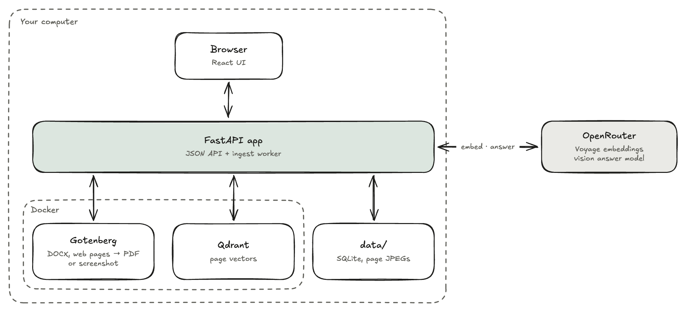
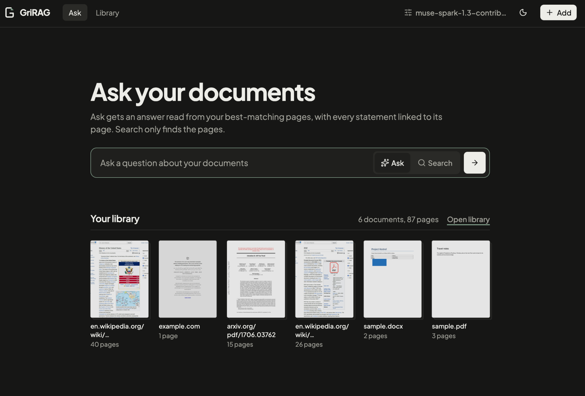

# GriRAG

Ask questions about your PDFs, Word files and web pages. GriRAG reads every page as an image, so tables,
charts and layout survive, and answers with citations to the exact pages it used. It runs on your computer,
for one user.


## How it works

<picture>
  <source media="(prefers-color-scheme: dark)" srcset="assets/pipeline-dark.png">
  
</picture>

Every document becomes page images: Word files and web pages go through Gotenberg first, web pages as a
screenshot cut into pages. Each page is embedded with a multimodal model and stored in Qdrant. A question is
embedded the same way, the 8 closest pages are sent to a vision model, and it answers only from them, citing
each page it used ([S1], [S2], …).

<picture>
  <source media="(prefers-color-scheme: dark)" srcset="assets/architecture-dark.png">
  
</picture>

The approach follows [PixelRAG](https://github.com/StarTrail-org/PixelRAG) (Apache-2.0). No PixelRAG code is
used; the answer prompt is adapted from its `SYSTEM_PROMPT_EVIDENCE_QA`.

## Quick start

Needs [uv](https://docs.astral.sh/uv/), Node.js, Docker Desktop and an [OpenRouter](https://openrouter.ai) key
with a few dollars of credit.

```bash
make setup     # Python and UI packages, .env, data/
# put your key into .env as OPENROUTER_API_KEY
make smoke     # optional: checks both models live, about $0.01
make run       # http://127.0.0.1:8000
```

## Using it



- **Add** files (or drop them anywhere) and links, one per line. Links to a PDF or DOCX are downloaded; other
  links are screenshotted.
- **Ask** a question to get an answer with citations. Sources shows the pages it cited, and every matching
  page follows below; click a page to see it large. **Search** finds pages without calling the answer model.
- **Library** lists every document with its status, with Retry and Delete.
- **Settings** shows the models and limits. Change them in `.env` and restart.

## Models and cost

Pages are embedded with `voyageai/voyage-multimodal-3.5` (about $1 per 1,000 pages) and questions answered by
`meta/muse-spark-1.3-contributor` (under $0.001 each), both through OpenRouter. Every call is logged with its
cost. Models are set in `.env`; `.env.example` lists the options, including free ones.

## Commands

| Command | What it does |
| --- | --- |
| `make run` | Starts Docker, Gotenberg and Qdrant, builds the UI if needed, serves the app |
| `make down` | Stops the containers |
| `make reembed` | Re-embeds every page after a model change or lost Qdrant data (app stopped; asks first) |
| `make test` | Unit tests, no network or Docker |
| `make lint` | Ruff and Oxlint |

## Limitations

- No OCR, keyword search or follow-up questions.
- Answers read the 8 best pages (`ANSWER_PAGES`), so facts spread over more pages can be missed.
- Web pages keep their first 40 pages; logged-in and paywalled sites index the login page.
- No authentication: keep it on 127.0.0.1.

## Development

Backend in `app/backend/` (Python 3.14, FastAPI; the RAG pipeline is in `app/backend/rag/`), UI in
`app/frontend/` (React, Vite, Tailwind, shadcn/ui). For live UI reloads, run `make run` and
`cd app/frontend && npm run dev`, then open http://localhost:5173. The design and its decisions are in
[PLAN.md](PLAN.md); [AGENTS.md](AGENTS.md) has the rules for contributing.

## License

[MIT](LICENSE)
